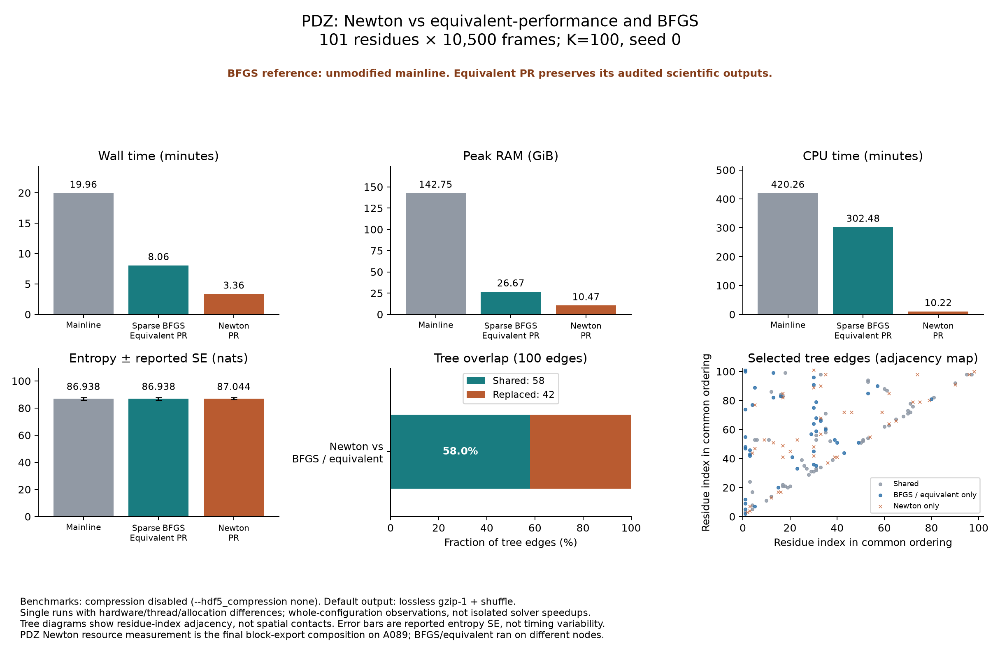
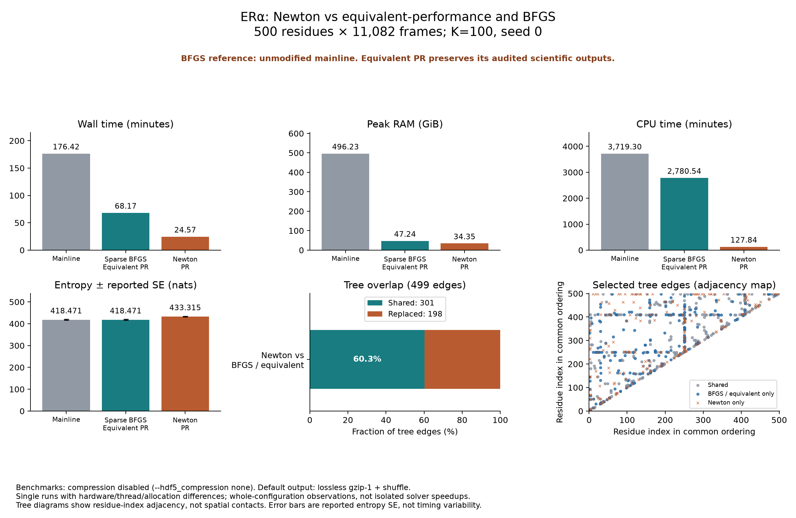
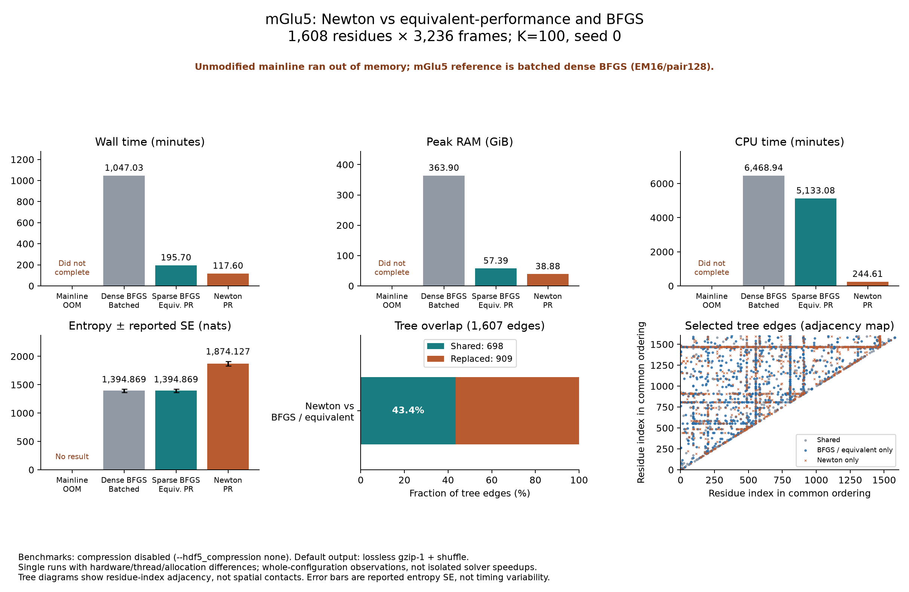

# Newton: three-system performance and tree comparisons

Benchmarks used compression-disabled output; current default output is lossless gzip-1/shuffle. All fits use K=100 and seed 0. These single-run whole-configuration comparisons differ in hardware, threading or allocation; they are not controlled solver-only speedups.

**mGlu5:** unmodified mainline ran out of memory. Its completed batched dense-BFGS reference is reported separately, not substituted into the mainline column.

## Wall time

| System (residues × frames) | Mainline (s) | Sparse BFGS / equivalent PR (s) | Newton PR (s) |
|---|---:|---:|---:|
| PDZ (101 × 10,500) | 1,197.897 | 483.604 | 201.825 |
| ERα (500 × 11,082) | 10,585.319 | 4,090.280 | 1,474.188 |
| mGlu5 (1,608 × 3,236) | OOM — no completed run | 11,741.805 | 7,055.840 |

## CPU time

| System (residues × frames) | Mainline (s) | Sparse BFGS / equivalent PR (s) | Newton PR (s) |
|---|---:|---:|---:|
| PDZ (101 × 10,500) | 25,215.830 | 18,148.814 | 612.919 |
| ERα (500 × 11,082) | 223,157.764 | 166,832.646 | 7,670.450 |
| mGlu5 (1,608 × 3,236) | OOM — no completed run | 307,984.806 | 14,676.622 |

## Peak RAM

| System (residues × frames) | Mainline (GiB) | Sparse BFGS / equivalent PR (GiB) | Newton PR (GiB) |
|---|---:|---:|---:|
| PDZ (101 × 10,500) | 142.745 | 26.666 | 10.469 |
| ERα (500 × 11,082) | 496.227 | 47.244 | 34.352 |
| mGlu5 (1,608 × 3,236) | OOM — no completed run | 57.390 | 38.882 |

## Additional runnable mGlu5 reference

| Configuration | Wall s | CPU s | Peak RAM GiB |
|---|---:|---:|---:|
| Dense BFGS + EM16/pair128 memory batching | 62,821.722 | 388,136.236 | 363.905 |

This modified reference completed; unmodified mainline did not. Its audited outputs match sparse BFGS / equivalent-performance.

## Observed Newton improvements

| System | Wall speedup vs mainline | Wall speedup vs sparse BFGS | Peak RAM reduction vs sparse BFGS | CPU-time reduction vs sparse BFGS |
|---|---:|---:|---:|---:|
| PDZ | 5.94× | 2.40× | 60.74% | 96.62% |
| ERα | 7.18× | 2.77× | 27.29% | 95.40% |
| mGlu5 | Unavailable — mainline OOM | 1.66× | 32.25% | 95.23% |

## Scientific results

| System | Mainline entropy ± SE (nats) | Sparse BFGS entropy ± SE | Newton entropy ± SE | Newton / sparse BFGS shared edges | MI Spearman |
|---|---:|---:|---:|---:|---:|
| PDZ | 86.938032 ± 1.059569 | 86.938032 ± 1.059569 | 87.044021 ± 0.855270 | 58/100 (58.00%) | 0.930147 |
| ERα | 418.471375 ± 1.999903 | 418.471375 ± 1.999903 | 433.315277 ± 1.766322 | 301/499 (60.32%) | 0.960746 |
| mGlu5 | OOM — no result | 1394.869247 ± 28.205934 | 1874.127190 ± 39.927457 | 698/1,607 (43.43%) | 0.852906 |

Mainline and equivalent-performance have identical retained tree edges, entropy, reported SE and MI arrays on PDZ and ERα. For mGlu5 this equality is against the batched dense-BFGS reference. Newton changes these outputs; higher fitted likelihood does not establish biological superiority. Shared-edge counts use undirected residue-name pairs; MI rank correlation uses identical pair ordering.

## EM solver diagnostics

| System | Mainline failed / recorded M-steps | Sparse BFGS failed / recorded M-steps | Newton failed / recorded M-steps |
|---|---:|---:|---:|
| PDZ | 426 / 1,261 | 426 / 1,261 | 0 / 1,343 |
| ERα | 2,250 / 6,216 | 2,250 / 6,216 | 0 / 6,941 |
| mGlu5 | OOM — no completed result | 9,103 / 20,614 | 0 / 23,117 |

The solvers have different stopping rules and diagnostics; these are their recorded failures, not a common residual test. The mGlu5 BFGS counts come from the batched dense reference, whose fit is preserved by equivalent-performance. Zero inner failures does not establish a global EM optimum.

## PDZ figure

## ERα figure

## mGlu5 figure

## Provenance and scope

The extraction reads retained tree/scalar/MI fields and small EM diagnostic arrays, not the large joint-probability tensors. `retained-tree-comparisons.json` (stored as `.json.gz` on the branch) records artifact paths, sizes, timestamps, selected-field hashes, input manifests and original summaries; CSVs provide the plotted numbers and exact tree-edge membership. This diagnostic is not a new full scientific-equivalence audit.

PDZ Newton timings use the final block-export candidate from `newton-final-export-pdzfull-20261018` (A089, eight CPUs), rather than the earlier solver-only run. Reference/equivalent timings come from their accepted full-input scientific intervals. mGlu5 uses the final Newton composition and accepted equivalent-performance run.

Full ERα Newton was newly measured at PR commit `588f0c7`, with all 11,082 frames and compression disabled, using the same input-selection and measurement helpers. `er-full-scientific-measurement.json` records its scientific interval. Input provenance was checked against the accepted equivalent-performance full-ERα run.

The older 500-frame ERα record is retained in the evidence JSON for provenance but is not plotted or used in these tables.

Regenerate figures and tables with `MPLCONFIGDIR=/tmp/cimist-mpl python3 make_comparison_figures.py` from this directory (requires Matplotlib and NumPy). The retained snapshots suffice to regenerate the figures; raw trajectories and the complete campaign harness remain in the BioHPC workspace. The launch/extraction scripts document that environment and are not a standalone public benchmark dataset.
